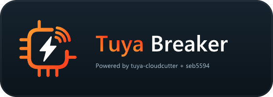

<!-- header:begin (generated from project metadata) -->
<h1 align="center">Tuya Breaker</h1>

  

---

  
   
  
  
   
  
  
  
  
   
  
  
  
  
  

<!-- header:end -->

**English** · [Deutsch](README.de.md)

Tuya Breaker combines **UnTuyaOS3 → Lightleak → Tuya-Cloudcutter** in one experimental Home Assistant Ingress workspace. It has its own release cycle and uses the independent [WiFi App Helper](https://github.com/seb5594/Home-Assistant-WiFi-Helper-App) to borrow one isolated radio. The [standalone UnTuyaOS3 app](https://github.com/seb5594/Home-Assistant-UnTuyaOS3-App) remains available separately.

> **This tool can permanently brick devices. Use at your own risk and accept responsibility for your hardware. Neither a completed transfer nor a valid dump guarantees that a device boots. Lightleak setup itself changes flash; its dumps are private post-exploit snapshots. The native Lightleak controller and Linux AP mode still need physical-device validation.**

Install Tuya Breaker and WiFi App Helper from the [Home Assistant Apps catalog](https://github.com/seb5594/Home-Assistant-Apps), configure the same private pairing secret and keep Protection mode/AppArmor on. All user interaction uses the app Configuration and Ingress Web UI; no host terminal is needed.

[Full setup and usage guide](tuya_breaker/DOCS.md) · [Changelog](tuya_breaker/CHANGELOG.md) · [WiFi Helper migration](https://github.com/seb5594/Home-Assistant-WiFi-Helper-App/blob/dev/README.md#migration-from-anti-tuya-wifi-helper)

## Tools

| Tool | Purpose and boundary |
| --- | --- |
| UnTuyaOS3 | Established interactive platform/firmware workflow for affected devices. |
| Lightleak | Generic BK7231T/N variants, stager/payload setup and complete private 2 MiB flash readout; no automatic replacement-firmware flash. |
| Tuya-Cloudcutter | Exact original device/firmware profile required; Flash or Detach with an explicit reviewed configuration. |

Only one tool and radio lease can run at a time. Tool/adapter selection stays locked until worker shutdown, cleanup and host restoration complete. The main app has no host network, host D-Bus, Docker API or SYS_ADMIN access.

## Community hardware references

The searchable OpenBeken hardware explorer reads the [official device database](https://openbekeniot.github.io/webapp/devicesList.html) programmatically, caches references and links to sources. Thanks to **OpenBeken / openshwprojects**, the **Elektroda teardown community** and **tuya-cloudcutter**. A hardware record does not prove exploit compatibility and never automatically approves a profile.

## Development

Each checkout builds independently. `project.json` defines this app's version and build pins. `vendor/wifi_helper/UPSTREAM.json` records the helper SDK revision and checksums; `vendor/untuyaos3/UPSTREAM.json` records the reviewed base snapshot. Generated build-context copies are checked by CI; no sibling app repository or floating runtime download is required. Uses the official Home Assistant Python 3.13 base and hass-workflows for both architectures.

Credit for the exploits and payloads belongs to tuya-cloudcutter and Kuba Szczodrzyński. The pinned CloudCutter fork supplies Python 3.13 binary TLS-PSK compatibility. [Original UnTuyaOS3](https://github.com/tuya-cloudcutter/UnTuyaOS3) · [Original CloudCutter](https://github.com/tuya-cloudcutter/tuya-cloudcutter) · [Lightleak fork](https://github.com/seb5594/lightleak).

<!-- support:begin (generated, shared text) -->
## Say thanks

All my projects are built in my spare time, just for the fun of it. Still, they take a lot of time and care, and many of the smart home gadgets I buy end up here because I want to make them cloud-free and smart-home ready. Every bit of support means a lot to me.

If my work helped you or turned out to be useful, show your appreciation with a hot drink for my next sleepless night.

 
<!-- support:end -->

<!-- license:begin (generated from the license file) -->
## License

Published under the [MIT License](LICENSE).
<!-- license:end -->
